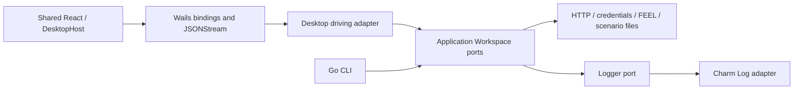

# Phase 5 — Wails scenario integration

> Historical migration evidence. Migration and packaged macOS acceptance are complete;
> the old runtime was removed on 2026-10-30. Use the root README for current commands.

Implemented 2026-10-29. Native interactive acceptance is pending with the user;
automated checks and successful packaging do not establish dialog/interaction parity.
Rust/Tauri remains available through its original commands.

## Application and adapters

The Wails host now enables open/read, validation, draft save, execution,
cancellation and report export. Both desktop and CLI drive the same Workspace.
Scenario inspection retains structurally valid drafts with semantic errors, so a
new HTTP node can be moved and saved before its path is entered. JSON draft saves
preserve layout, enforce structural/resource limits, use private atomic writes,
and refuse YAML destinations. Opening preserves the original JSON/YAML source.



`internal/adapters/inbound/desktop` owns the desktop's single active/preparing
run and one completed report. It imports no native framework. Admission happens
outside the registry lock; owner closure interrupts preparation. Rejected starts
retain the previous completed report. Cancellation and export require the matching
run ID. The completed report is committed before its terminal message is delivered,
including when export is requested immediately by the frontend callback.

The Wails adapter uses the pinned SDK's **HandleStream / JSONStream** API. Its
native transport already provides ordering, bounded queues and connection contexts;
there is no custom listener, polling loop, subprocess bridge or event batching layer.
The stream queues a start acknowledgement before draining the engine's one-entry
event channel. Failed acknowledgement delivery cannot start HTTP. Window/page or
receiver teardown interrupts work; normal Cancel keeps the stream attached and
permits eligible bounded cleanup. Failed stream delivery still retains a safe
partial report. Normal terminal delivery includes the complete safe report v3.

The frontend validates every frame, buffers bounded early messages until the
acknowledged ID is known, ignores foreign/late messages, and disposes on terminal
delivery, protocol failure, disconnect or page teardown. The shared run store
continues to reconcile events from the final report. Synthetic probe traffic uses
its independent topic and is never used by Run.

Native dialogs, close protection and theme remain Wails adapters. Generated
bindings come from the official task. Scenario shape/semantic failures use typed
safe diagnostics rather than Wails error-string parsing. Runtime and framework
logging continue through Charm Log; no fmt diagnostic logger was added.

## Verification

From the repository root:

```sh
npm --prefix apps/desktop run wails -- task common:generate:bindings
npm --prefix apps/desktop run typecheck
npm --prefix apps/desktop test -- --maxWorkers=2
npm --prefix apps/desktop run build
npm --prefix apps/desktop run wails -- build
npm --prefix apps/desktop run wails -- package
node scripts/check-migration-boundaries.mjs
```

From `go/`:

```sh
go test ./... -count=1 -timeout=120s
go test -race ./internal/application ./internal/adapters/inbound/desktop -count=1 -timeout=90s
go vet ./...
CGO_ENABLED=0 go build -o bin/interl-go-headless ./cmd/interl-go
```

Regressions cover editable invalid drafts and malformed-source write protection;
JSON/YAML reads; extension/read/write errors; ordered stream/report correspondence;
early final messages; ID isolation; single-run admission; cancellation; failed
acknowledgements with zero HTTP; page/receiver teardown; shutdown during preparation;
report retention/export races; bounded malformed delivery; and native dialog
cancellation through the frontend adapter. Existing editor/run suites remain shared.

The SDK's native stream queue is the transport bound; core report/event budgets
remain the execution bounds. Consumers must keep draining or close their receiver.
No native UI was launched during automated verification.

Observed results: 257 frontend tests passed across 43 files with two workers;
the full Go suite, targeted desktop/application race tests, vet, architecture and
headless checks passed. The official production build/package tasks generated
14 service methods and a macOS app whose ad-hoc signature verification passed.
The initial unconstrained frontend run hit worker-startup timeouts while builds
were running; the bounded-worker rerun completed without test failures.

## Run and native acceptance

Start the Go test server separately:

```sh
go -C go run ./cmd/interl-test-server
```

Start Wails from the repository root, with the fake credentials loaded:

```sh
(set -a && source ./example.env && npm --prefix apps/desktop run wails -- dev)
```

Use the living Feature showcase. The user still needs to confirm:

1. Open the JSON and YAML files using the native dialog; cancel the dialog and
   confirm the current draft stays selected. Check reload/initial fit, workflow
   navigation, lifecycle accordions, panel resizing and isolated theme/layout preferences.
2. Enter Edit, create/move an HTTP node before configuring its path, and save the
   unfinished draft to JSON. Reopen it, repair the validation error, and check
   rename, undo/redo, Save/Discard, mode changes and close protection.
3. Run both XOR outcomes. Inspect grouped logs, nested invocation scopes, graph
   markers, read-only captured layout and the complete safe report. Expect twelve
   HTTP 200 responses and completed cleanup on the unchanged showcase.
4. Cancel during long polling; check bounded cleanup and the cancelled report.
   Reload during execution; the old receiver should stop its HTTP and permit a
   subsequent run. A failed run must not leave Run disabled.
5. Export and cancel report dialogs; check write failures, native close/cancel
   decisions and dark/light/system theme. Restart without credentials to confirm
   safe missing-secret diagnostics, then restart with `example.env` loaded.

The Phase 5 native gate remains pending until these interactions are observed.
Update 2026-10-30: the user chose Wails + Go as primary and skipped performance
comparisons. Packaged verification and the remaining native checks are tracked in
[Phase 6](phase-6-packaging.md); this does not mark unobserved interactions passed.
