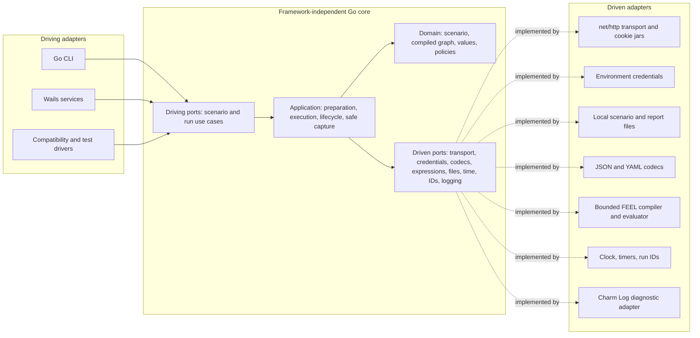

# Go + Wails migration

- Status: **Complete, including user-verified packaged macOS acceptance.**
- Accepted 2026-10-30: Wails + Go is the sole implementation; the user explicitly authorized Rust/Tauri removal.
- Performance comparisons were skipped by request. The package was verified by the user before retirement.
- Rust/Tauri sources, tooling, dependencies and build cache have been retired. The canonical JSON Schema now generates TypeScript and the Go embedded schema without Cargo.
- Hexagonal ports/adapters and the shared desktop/CLI application remain required.
- Earlier phases below are historical evidence. Current removal and verification: [retirement record](../docs/migration/phase-7-retirement.md).

## Outcome and scope

The existing React editor runs against either desktop host. Go CLI and Wails use the **same Go application core**, with identical scenario semantics. The headless CLI never imports or starts Wails. Domain and application packages do not depend on a desktop framework, filesystem implementation, HTTP library, or concrete FEEL library.

This is an M3.5 compatibility migration, not an opportunity to add M4 scheduling, parallel gateways, new expression syntax, or a new scenario format. Existing native acceptance gaps remain visible; Rust is the reference for implemented behavior, not proof that every behavior is correct. Disagreements with the documented contract need an explicit decision and regression tests.

## Hexagonal design

The application exposes driving ports for use cases and consumes driven ports for external capabilities. Adapters translate those ports into concrete protocols. All source dependencies point inward; an application calling an HTTP interface does not create a dependency on the HTTP adapter.



### Responsibilities and dependency rules

| Area | Owns | Must not own |
| --- | --- | --- |
| Domain | Scenario meaning, graph/dataflow rules, compiled instructions, typed values, gateway decisions, lifecycle eligibility and result precedence | Wails, CLI flags, filesystem/network access, environment lookup, wire streaming |
| Application | Validate/compile/prepare/run/cancel use cases; VU/session ownership; invocation state; cleanup orchestration; sensitivity tracking; redaction; bounded safe events/reports | Concrete HTTP clients, dialogs, Go process signals, shell commands, desktop runtime |
| Driving ports | Host-independent request/result types and run-handle behavior | Wails contexts, generated bindings, Tauri envelopes, CLI exit codes |
| Driven ports | Small consumer-owned interfaces for replaceable capabilities | Adapter-specific types such as `http.Client`, cookie jars, filesystem handles, FEEL-library ASTs |
| Adapters | External protocol translation and resource management | A second validator, interpreter, redaction policy, or lifecycle controller |
| Composition roots | Choose concrete adapters and wire dependencies | Business rules or global service locators |

Interface definitions live with their consuming application package. Use interfaces at actual replacement/test seams; do not create an interface for every struct or function. Keep typed calls at request/expression boundaries rather than introducing a reflective node-processing framework.

Domain code can use ordinary standard-library value types. Application code can use `context.Context`, synchronization, and bounded channels. No ambient `os.Getenv`, `os.ReadFile`, `time.Now`, process-global mutable session, or framework calls inside the core. External effects enter through explicit dependencies.

### Driving ports

The precise Go signatures are established in Phase 1. These are required operations, not separate services per operation:

- **Scenario use cases:** decode/load, validate, compile, and save a draft; return source metadata and structured diagnostics. Validation is offline and does not resolve credentials.
- **Run use cases:** prepare from a validated immutable document, start, cancel by run ID, inspect terminal state, and obtain a safe report. Preparation failures do not start HTTP.
- **Run handle:** stable run ID, bounded stream of already-safe events, completion result, and explicit disposal behavior. CLI and desktop consume the same handle.

Desktop services translate the run handle into the existing live protocol. CLI maps outcomes to the current stdout/stderr, report-file, signal, and exit-code contract. Neither changes engine outcomes.

### Driven ports and adapter contracts

| Port | Initial adapter | Required replacement seam |
| --- | --- | --- |
| HTTP session factory / session transport | Go `net/http`, per-VU cookie jar and configured TLS transport | Fake transport, another HTTP implementation, future transport options without changing workflows |
| Credential resolver | Declared environment references | Fake credentials; later another credential source without exposing values to the frontend |
| Scenario codec | Strict JSON and YAML decoding | Another parser implementation with identical duplicate-key, number, unknown-field, limit, and source-location behavior |
| Expression compiler/evaluator | Explicitly selected bounded FEEL implementation | Another evaluator behind a typed, bounded contract; no concrete-library AST in domain state |
| Scenario/report storage | Local filesystem | In-memory tests or another storage adapter; shared path/input-overwrite protection |
| Diagnostic logger | Charm Log v2.0.1 (`charm.land/log/v2`) | In-memory/test logger or another logging backend; safe structured metadata, no process termination or run-event coupling |
| Clock/timers and ID source | System implementations | Deterministic lifecycle/cancellation tests and reproducible run IDs |

Transport returns private, bounded response data to the application. **Redaction and sensitivity policy execute before data reaches any public event/report port.** Wails and CLI adapters never receive raw credentials, cookies, auth payloads, or extracted secret values and are not responsible for scrubbing them afterward.

The domain defines the admitted expression operations and resource limits. The FEEL adapter retains library ASTs privately behind predicate/scalar-expression handles; the core checks declared types and dataflow. The external library evaluates predicates, extraction paths and authentication token paths. Replacing an adapter must document semantic differences and must not implicitly expand the admitted syntax.

A VU owns its session state and transport handle. The HTTP adapter owns concrete connection pools and cookie jars. Reusable calls and lifecycle phases share the caller's session according to the current contract; other VUs cannot access it. Host adapters never construct or distribute session clients.

### Frontend hexagon

Keep one React source tree. Introduce a typed `DesktopHost` port for scenario operations, run streaming/cancellation/export, native dialogs, theme, and close handling. Provide Tauri, Wails, and explicit browser-preview adapters.

- React stores/components import the host port/facade, not `@tauri-apps/*` or Wails generated bindings.
- Generated Wails bindings and Tauri commands remain adapter implementation details.
- Select the host explicitly at build/bootstrap time. Do not infer a failed Wails bridge means Tauri or browser preview.
- Preserve runtime validation of public payloads, protocol negotiation, cancellation on incompatible streams, and unsubscribe/disposal behavior.
- Keep current Tauri launch commands working. Do not copy the UI into a second frontend or require the Go desktop to spawn the Rust engine.
- Include the direct native calls currently in `App.tsx` and `lib/theme.tsx`, not only `lib/tauri.ts`.

### Proposed repository layout

```text
apps/desktop/                        Existing shared React/Vite source and Tauri project
  src/lib/desktop/
    host.ts                          Frontend port and public types
    tauri.ts                         Existing host behavior behind the port
    wails.ts                         Generated-binding/event adapter
    browser.ts                       Explicit preview behavior
go/
  go.mod / go.sum                     Separate Go module; no Cargo changes
  cmd/interl-go/                     CLI composition root, binary interl-go
  main.go                            Standard Wails desktop composition root
  Taskfile.yml / build/               Wails-generated dev/build/signing tasks
  internal/
    domain/                          Pure scenario/graph/value/policy model
    application/                     Use cases, interpreter, run controller, ports
    contracts/                       Scenario/report/diagnostic wire DTOs and mapping
    adapters/
      inbound/cli/
      inbound/wails/
      outbound/httpclient/
      outbound/envcredentials/
      outbound/scenariocodec/
      outbound/feel/
      outbound/localfiles/
      outbound/system/
      outbound/charmlog/
    bootstrap/                       Shared engine wiring; no Wails import
  frontend/dist/                     Generated shared frontend build, ignored
tests/compatibility/                 Language-neutral fixtures and comparison harness
crates/                              Existing Rust implementation, retained
```

Keep Wails initialization in its composition root; the CLI must not import the desktop adapter through shared bootstrap code. CI checks the CLI dependency graph and builds/tests core packages without a webview or desktop SDK. Wails assets are built from the existing frontend into a generated embedding directory; do not maintain a copied source tree or commit generated bundles. Adapt exact asset wiring to the pinned Wails template in Phase 1.

Example extensions: replace the Wails host without changing application use cases; add a new driving API adapter; replace environment credential lookup; change HTTP implementation while preserving session semantics; replace FEEL implementation against the same expression corpus. A new feature still requires explicit domain/application work if it changes semantics.

## Compatibility contract

Freeze fixtures from the current working implementation before porting. Do not invent a third product specification or use success on the showcase as the entire test suite.

| Surface | Migration requirement |
| --- | --- |
| Scenario files | Existing schema version 2, JSON/YAML equivalence, omitted defaults, stable IDs and references, editor draft/layout round trips |
| Validation | Supported graphs, inferred merges, branch dataflow, recursion rejection, typed inputs/outputs, stable diagnostic category/code/path; retain source locations |
| Expressions | Current bounded FEEL extraction, predicates, named typed outputs, missing/null/type/number behavior and limits; reject unsupported syntax |
| Execution | Existing node types, call scopes, authentication modes, session updates, exclusive routing and Initialize/Iteration/Cleanup behavior |
| HTTP | Base URL/path handling, encoding, timeouts, cancellation, redirect/retry policy, cookie isolation, request/response limits and truncation |
| Safety | Credential resolution stays backend-only; auth sensitivity propagates across calls; all public errors/events/reports remain safe |
| Reports and live events | Report version 3 and live protocol version 3, current fields including safe graph metadata and scoped invocation identity |
| CLI | `validate`, `run`, `--output`, stdout/stderr separation, exit codes 0/1-reserved/2/3/130, input-overwrite protection, Ctrl-C partial reports |
| Desktop | Existing View/Edit, dirty-state protection, validation, canvas/inspector, local layout preferences, run visualization, native dialogs/theme/close behavior |

`schemas/scenario.schema.json` is now authoritative. Go embeds a generated copy and TypeScript file types are generated from the same source. `schema:check` and Go contract tests enforce agreement. Wails service bindings remain separate from the scenario schema.

Preparation and execution need explicit lifetime contracts: user cancellation stops iteration work, eligible cleanup uses its own bounded context, and cleanup failure cannot erase the primary failure. Port current eligibility, timeout defaults/maxima, and cancellation/result precedence exactly; do not approximate them with a generic `defer`.

Standard Wails startup/build correction: [setup and verification](../docs/migration/wails-standard-setup.md).
No custom launcher or hand-built app bundles remain.

## Delivery phases

Phase 1 steps, evidence and remaining native checks: [shell journal](../docs/migration/phase-1-shell.md).
Phase 2 implementation, parser/URL decisions and compatibility evidence:
[scenario and FEEL journal](../docs/migration/phase-2-scenario-feel.md).
The user upgraded global Go to 1.27.3 before Phase 1; standard Go commands now use it.
The user also required a replaceable logging port with Charm Log as its first adapter.

Progress and reproducible evidence: [Phase 0 baseline and work journal](../docs/migration/phase-0-baseline.md).
The reference passes 257 Rust tests and 244 frontend tests. Shared fixtures include
34 expression cases and 23 offline CLI validation outcomes. Exact migration pins
are Wails v3.0.0 and Go 1.27.3; both are now installed. Additional Phase 2 corpora
cover 119 scenario cases and 50 expression cases without rewriting the frozen baseline.

### Phase 0 — Baseline and feasibility inventory

- Record current Rust/frontend checks, known native acceptance gaps, public schemas, supported expressions, redaction limits and CLI outcomes. Snapshot expected results without committing secrets.
- Inventory desktop runtime calls and source maps/diagnostic behavior. List adapters and their contracts before coding.
- Confirm local Go and desktop prerequisites without changing global defaults. Pin a released Wails/toolchain combination and lock dependencies; avoid `@latest` in repeatable scripts.
- Verified selection: Wails v3.0.0 and Go 1.27.3, recorded in `tests/compatibility/toolchains.json`. At baseline Go 1.27.2 was installed; the user upgraded global Go to 1.27.3 before Phase 1. Standard Go commands use that installation.
- Define compatibility normalization and benchmark procedures before seeing Go results.

**Gate:** reproducible Rust baseline and complete parity checklist; package/FEEL feasibility risks identified. No Go features claimed yet.

### Phase 1 — Hexagonal skeleton and Wails smoke test

- Create the separate Go module, domain/application boundaries, minimal driving/driven ports, and explicit composition roots.
- Add the frontend host port and Tauri adapter without changing existing product behavior; retain a compatibility facade while migrating imports if needed.
- Scaffold a Wails window loading the shared React source through its Wails build target. Prove typed calls, native dialogs/theme, close events, and bounded synthetic event subscription/disposal.
- Add a headless `interl-go` entry point and fake application adapters for isolated tests. An unfinished feature reports unavailable; it must not silently call Rust or send real requests.
- Add dependency-boundary checks: no Wails/OS/network implementation in domain/application, no Wails dependency in the CLI, and no native-host imports outside frontend adapters.
- Provide distinct app identifiers, development ports, build outputs and local host-preference namespaces so both desktops can coexist without interfering with windows or unsaved files. Preserve current Tauri preferences; give experimental Wails preferences a separate namespace.

**Gate:** both existing Tauri and experimental Wails launch independently; Go CLI builds without native desktop prerequisites; architecture boundaries have automated enforcement. This is a shell spike, not engine parity.

### Phase 2 — Scenario and FEEL compatibility

Completed: Go CLI validation, strict codecs, graph/dataflow compilation and the
pinned pbinitiative FEEL parser/evaluator behind ports. The internal evaluator
has been removed. Predicates, extraction values and bearer tokens use external
AST evaluation handles. There are 142 scenario cases (23 frozen + 119 extended)
and 84 shared expression cases; nine runtime outcomes intentionally use the
external library's behavior and differ from the strict Rust reference. Those
differences are explicit in `tests/compatibility/feel-library-outcomes.json`.
See the
[Phase 2 journal](../docs/migration/phase-2-scenario-feel.md).

- Implement strict codecs, mapping to domain types, validation, graph/dataflow compilation and structured diagnostics behind application ports.
- Build a shared expression corpus from current acceptance/rejection tests. Evaluate Go FEEL libraries against the supported subset and bounds before choosing an adapter.
- If no library matches safely, document a bounded compatible subset implementation and its test evidence; do not replace FEEL with another expression language, silently accept more syntax, or retain a Rust evaluator as hidden production fallback.
- Implement Go CLI `validate`, including offline behavior and exit codes. Run both parsers over valid, invalid, malformed, duplicate-key, oversized, Unicode and numeric-boundary fixtures.

**Gate:** schema/validation compatibility passes; expression checks preserve the Rust reference and explicitly record the selected external library's runtime differences. No custom evaluation fallback remains. Phase 3 must consume the prepared external predicate/extraction/token handles.

### Phase 3 — Executable Go vertical slice

Completed 2026-10-29. Implementation, verification commands and remaining scope:
[Phase 3 execution journal](../docs/migration/phase-3-execution.md).

- Implement Go HTTP/session, credential and system adapters, plus the application run controller and interpreter for one complete journey.
- Cover authentication → HTTP → extraction → exclusive branch → reusable call → cleanup, with one group/VU/iteration and safe event/report output.
- Add Go CLI `run`, report writing, preparation failure, transport failure, Ctrl-C and bounded cleanup, using the same application port intended for Wails.
- Keep raw response/session state internal. Verify secret sentinels are absent from logs, diagnostic text, public streams and reports, including failure paths.
- Use fake transports/clocks for deterministic tests and the existing local test server for real HTTP behavior. Run Rust and Go separately against reset fixture state, not simultaneously against mutable auth fixtures.

**Gate:** the vertical slice passes through both fake adapters and the real HTTP adapter; CLI outputs match normalized Rust expectations; cancellation and secret checks pass.

### Phase 4 — Complete existing engine and CLI parity

Completed 2026-10-29. Matrix, fixes, checks and the explicit FEEL boundary:
[Phase 4 journal](../docs/migration/phase-4-parity.md).

- Port all currently supported M3.5 nodes, value mappings, session/auth modes, call scoping, routing cases and bounded-resource/error behavior.
- Port meaningful core/engine/HTTP/CLI regressions. Preserve test intent across languages rather than translating Rust internals mechanically.
- Run every runnable JSON/YAML example against both CLIs, including the complete living showcase, both branch outcomes, long polling, auth failures and cleanup failures.
- Expand the compatibility harness with negative inputs, repeated calls/IDs, cancellation races and limits; preserve semantics even when implementation scheduling differs.

**Gate:** Go passes the full documented parity matrix with explicit exclusions limited to known baseline gaps. CLI remains independent of Wails.

### Phase 5 — Wails product integration and native parity

Implemented 2026-10-29; native acceptance pending. Wiring, automated evidence and
the manual checks are in the [Phase 5 journal](../docs/migration/phase-5-desktop.md).

- Wire Wails services to the same Go application used by `interl-go`; replace synthetic events with safe run-handle output.
- Map the current desktop protocol and native operations through the Wails host adapter. Handle event-before-start-ack races, run ID isolation, late events, cancellation, bounded progress and terminal report delivery.
- Exercise real open/save/cancel/report dialogs, close protection, theme, environment startup, malformed inputs and permission failures on macOS first.
- Re-run editor and captured Run behavior: dirty state, undo/redo, shared workflows, node/edge scopes, lifecycle accordions, compact centered default boxes, manual move/resize persistence, initial fit and reduced motion.
- Keep the Tauri host running through its original commands and tests. Document separate runnable commands only after they work.

**Gate:** Wails and Tauri can open the same examples and show equivalent safe results; native acceptance is recorded as observed, not inferred from unit tests.

### Phase 6 — Packaging and accepted migration decision

Scope updated by the user on 2026-10-30. Evidence and manual steps:
[Phase 6 packaging journal](../docs/migration/phase-6-packaging.md).

- **Skipped by user:** Rust/Go CLI performance comparisons and Wails/Tauri startup,
  canvas and live-rendering performance comparisons. No performance parity claim
  is made, and benchmarks are not a prerequisite for the chosen implementation.
- **Decided:** Wails + Go is the primary implementation. Prefer it in current
  startup documentation; retain Rust/Tauri and its schema tooling until removal
  is explicitly requested.
- Build the macOS release `.app` through the official Wails package task; inspect
  the bundle, embedded production frontend, native dependencies and signature.
- User verifies packaged launch outside development mode, native file dialogs,
  save/reopen, run/cancel/cleanup, export, close/relaunch and environment handling.
  Automated inspection does not establish those native interactions.
- Developer ID signing/notarization and other platforms remain separate release
  work; do not claim they were verified by a local ad-hoc signed macOS package.

**Gate:** automated package evidence plus recorded user acceptance. The runtime
choice is settled; packaging acceptance remains separate. No Rust deletion.

## Test strategy and architecture enforcement

1. **Domain/application tests:** pure model and policy checks plus in-memory codecs, transport, credentials, clock/timers and storage. Exercise cancellation and cleanup without sleeps or a desktop window where practical.
2. **Adapter contracts:** run the same transport/storage/credential/expression expectations against fake and real adapters where applicable. Test explicit context/error/resource ownership, including session closure.
3. **Cross-language comparison:** normalize only declared nondeterminism: generated run/invocation IDs through bijective mapping, timing values, platform paths and fixture-declared volatile headers. Do not erase event scopes, meaningful event ordering, terminal states, route selection, redaction/omission markers, request counts or cleanup results. Deterministic golden HTTP fixtures avoid unrelated header/timing noise.
4. **Frontend host contracts:** run store/bridge tests against Tauri and Wails adapter fakes, including malformed/version-mismatched messages, terminal delivery and disposal. Keep shared React component tests host-independent.
5. **Dependency rules:** inspect Go import/dependency graphs in CI and enforce frontend import boundaries. Demonstrate at least one real adapter replacement with the same application tests, not only a directory diagram.
6. **Native acceptance:** test actual packaged desktop behavior; headless tests do not establish native dialog, focus, theme or shutdown correctness.

Performance acceptance uses a reproducible baseline and explicit tolerances agreed before comparison. Immediate rejection conditions are lost events required for correctness, unbounded memory/streams, incorrect cancellation/cleanup, or secret leakage—not an arbitrary language speed target.

## Coexistence and maintenance

- Rust `interl` keeps its name and launch commands. Experimental Go CLI is `interl-go`; desktop builds/outputs have distinct names and bundle IDs.
- Existing tests remain required. Add Go checks independently so the Rust baseline stays usable if experimental work is incomplete.
- Keep shared scenario/report fixtures and the living showcase authoritative for both implementations. Feature changes extend JSON/YAML, exercise guidance and relevant Rust/Go regressions together; UI-only changes update guidance without inventing scenario fields.
- During the experiment, label capability gaps explicitly in development documentation. Do not expose controls claiming an unfinished Go feature works.
- Reconcile architecture and milestone status at each gate. M3.5 native acceptance is not silently completed, and M4 is not started as a side effect of porting.
- Track implementation status and evidence in this plan as phases land; no speculative completion marks.

## Sources and toolchain checks

- [Wails v3 installation and platform prerequisites](https://wails.io/quick-start/installation/).
- [Wails services and generated bindings](https://wails.io/features/bindings/services/).
- [Existing product design](../DESIGN.md), [M3.5 implementation plan](milestone-3.5.md), [scenario examples and showcase](../scenarios/examples/README.md).

These sources inform scaffolding; the core ports and migration compatibility contract belong to Interleaving, not to either desktop framework.
